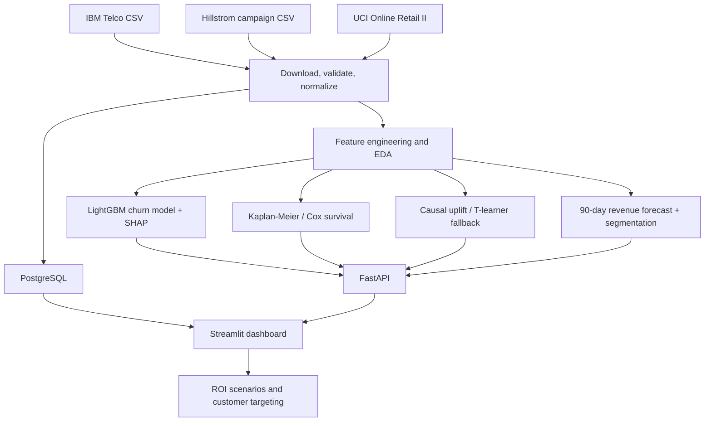

# Customer Lifetime Value & Churn Intelligence System

A Dockerized customer analytics project that combines churn prediction, survival analysis, email-campaign uplift modeling, forward revenue forecasting, customer segmentation, and campaign ROI simulation. The application includes a Streamlit dashboard, FastAPI endpoints, PostgreSQL storage, automated tests, project documentation, and a presentation.

> **Current validation status:** IBM Telco Customer Churn has been downloaded and displayed successfully in the user's Docker environment. The dashboard screenshot shows a held-out LightGBM evaluation. Hillstrom has encountered a TLS certificate error, and successful processing of Online Retail II has not yet been confirmed. The complete multi-dataset pipeline must not be described as fully verified until all dataset, training, database, API, and test checks pass.

## Contents

- [Project overview](#project-overview)
- [Objectives](#objectives)
- [Datasets](#datasets)
- [Architecture](#architecture)
- [Technology stack](#technology-stack)
- [Getting started](#getting-started)
- [Download and prepare datasets](#download-and-prepare-datasets)
- [Train and evaluate models](#train-and-evaluate-models)
- [Run tests and smoke checks](#run-tests-and-smoke-checks)
- [Dashboard and API](#dashboard-and-api)
- [Observed churn-model results](#observed-churn-model-results)
- [Limitations and responsible interpretation](#limitations-and-responsible-interpretation)
- [Troubleshooting](#troubleshooting)
- [Documentation and submission files](#documentation-and-submission-files)
- [Final acceptance checklist](#final-acceptance-checklist)
- [Main source files](#main-source-files)

## Project overview

The system provides a practical workflow for analyzing customer churn and campaign response:

1. Ingest public datasets and validate their structure.
2. Store prepared data in PostgreSQL.
3. Explore customer characteristics and engineer features.
4. Train a LightGBM churn classifier and explain model predictions with SHAP when available.
5. Use Kaplan–Meier and Cox proportional-hazards analysis for a clearly defined survival/event proxy where the data supports it.
6. Estimate treatment-response uplift from campaign treatment/control data.
7. Forecast near-term revenue, create customer segments, and estimate campaign ROI under explicit assumptions.
8. Present outputs in Streamlit and expose selected functions through FastAPI.

The datasets represent different populations and tasks. They are **not joined as though they describe the same customers**.

## Objectives

- Load public customer and campaign datasets into PostgreSQL.
- Perform exploratory data analysis (EDA), data validation, and feature engineering.
- Train and evaluate a LightGBM churn classifier.
- Explain churn predictions using SHAP or a documented fallback.
- Estimate survival with Kaplan–Meier and Cox models when the event definition and follow-up data are defensible.
- Use treatment/control campaign data for uplift modeling rather than only ranking customers likely to churn.
- Forecast forward 90-day revenue, calculate assumption-based contribution value, and segment customers.
- Provide a Streamlit dashboard and ROI simulator, plus FastAPI endpoints.

## Datasets

| Dataset | Intended use | Source and current status |
|---|---|---|
| IBM Telco Customer Churn | Churn classification, EDA, service/charge features, churn explanations, and telecom segmentation | IBM-hosted public CSV. Confirmed in the user's environment: **7,043 rows × 22 columns**. |
| Hillstrom MineThatData email campaign | Treatment/control uplift modeling for email conversion | Original download has failed in the user's environment with a self-signed TLS certificate error. Configure a trusted CA or validate an approved mirror before use. |
| UCI Online Retail II | Purchase-frequency and revenue features, forward 90-day revenue forecast, customer segmentation, and purchase-inactivity survival proxy | Downloader is included; successful download and processing remain unconfirmed. |
| Optional Criteo uplift sample | Additional uplift benchmark | Optional downloader; not required for the primary workflow. |

Raw datasets are downloaded at runtime and are not bundled in the project archive. Follow the source's terms, license, and attribution requirements.

### Important dataset constraints

- IBM Telco is cross-sectional and does not contain complaint logs or longitudinal usage history. Do not fabricate these fields.
- Hillstrom models email campaign response; it does not directly establish that a telecom discount prevents churn.
- Online Retail II describes purchasing transactions, not confirmed subscription cancellation.

## Architecture



## Technology stack

- **Runtime:** Python 3.11
- **Data store:** PostgreSQL
- **Packaging and services:** Docker, Docker Compose
- **Dashboard and API:** Streamlit, FastAPI
- **Data and modeling:** pandas, NumPy, scikit-learn, LightGBM, SHAP
- **Survival analysis:** lifelines
- **Uplift modeling:** CausalML when installed and compatible; documented scikit-learn T-learner fallback
- **Testing:** pytest

### NumPy and PyArrow compatibility

The project pins `numpy==1.26.4` and `pyarrow==18.1.0` to avoid the reported incompatibility in which a newer PyArrow requires NumPy 2.x. Rebuild the app image after changing dependency pins; restarting an existing container does not reinstall packages.

## Getting started

Run commands from the project root.

### 1. Configure environment variables

```bash
cp .env.example .env
```

Edit `.env` and set a strong `POSTGRES_PASSWORD`. Do not commit `.env`, credentials, or private certificates.

### 2. Build and start the services

```bash
docker compose up --build -d
docker compose ps
```

Local endpoints:

- Streamlit dashboard: <http://localhost:8501>
- API health endpoint: <http://localhost:8000/health>
- Interactive API documentation: <http://localhost:8000/docs>

### 3. Verify NumPy and PyArrow

```bash
docker compose exec app python -c "import numpy, pyarrow; print('NumPy:', numpy.__version__); print('PyArrow:', pyarrow.__version__)"
```

Expected versions:

```text
NumPy: 1.26.4
PyArrow: 18.1.0
```

If dependency pins changed, rebuild the app image:

```bash
docker compose down
docker compose build --no-cache app
docker compose up -d
```

## Download and prepare datasets

Download and normalize the primary datasets:

```bash
docker compose exec app python -m src.datasets --dataset all
```

The downloader attempts datasets independently and prints a per-dataset summary. A successful Telco download does not imply that Hillstrom and Online Retail II also succeeded. Review the final summary and inspect the generated normalized files before training.

For isolated troubleshooting, run one dataset at a time:

```bash
docker compose exec app python -m src.datasets --dataset telco
docker compose exec app python -m src.datasets --dataset hillstrom
docker compose exec app python -m src.datasets --dataset retail
```

Optional Criteo sample (potentially a large download):

```bash
docker compose exec app python -m src.datasets --dataset criteo --criteo-rows 500000
```

## Train and evaluate models

After the required datasets have downloaded and normalized successfully:

```bash
docker compose exec app python -m src.train_real
```

Review generated outputs, including `artifacts/training_summary.json` and `artifacts/run_manifest.json` if emitted by the run. Confirm that each model workflow completed and that metrics are based on held-out data. Do not infer training success merely because the dashboard opens.

## Run tests and smoke checks

### Automated test suite

```bash
docker compose exec app python -m pytest -q
```

### Application/database smoke test

```bash
docker compose exec app sh -lc 'PYTHONPATH=/app python /app/scripts/smoke_test.py'
```

The `PYTHONPATH=/app` prefix makes the project root available to Python when the smoke test is invoked by file path. The smoke test may reveal separate issues if PostgreSQL is unavailable, data has not been loaded, or model artifacts are missing.

### Required survival dependency and test

`lifelines` is a project dependency and should be installed in the Docker image. Verify it inside the running container:

```bash
docker compose exec app python -c "import lifelines; print('lifelines:', lifelines.__version__)"
docker compose exec app python -m pytest -q tests/test_core.py
```

If the import fails, rebuild the image and inspect the Docker build logs. Do not silently skip the survival integration test.

## Dashboard and API

The Streamlit dashboard provides the following sections. The availability and completeness of results depend on successful data preparation and model training.

| Section | Purpose |
|---|---|
| **Overview & EDA** | Dataset size, churn rate, tenure, duplicate/missing-value checks, numeric summaries, and contract distribution |
| **Churn + SHAP** | Held-out churn metrics and feature importance/explanations |
| **Survival** | Kaplan–Meier/Cox summaries and individual survival estimates where valid follow-up data exists |
| **Uplift** | Treatment/control response modeling and ranked targeting estimates |
| **CLV + Segments** | Forward 90-day revenue forecast and customer clusters |
| **ROI** | Scenario inputs for campaign cost, contribution, and estimated incremental effect |
| **PostgreSQL** | Database status and table inspection |

Use the interactive API documentation at <http://localhost:8000/docs> as the source of truth for current endpoint schemas. Check `/health` first, then test model endpoints after their required artifacts and input data are available.

## Observed churn-model results

The user's Streamlit screenshot for IBM Telco showed the following held-out LightGBM metrics on a test set of 1,761 customers.

| Metric | Observed value |
|---|---:|
| Total dataset rows | 7,043 |
| Training rows | 5,282 |
| Test rows | 1,761 |
| Test churn rate | 26.52% |
| ROC-AUC | 0.8406 |
| PR-AUC | 0.6459 |
| Precision at threshold 0.5 | 0.5428 |
| Recall at threshold 0.5 | 0.7602 |
| F1 at threshold 0.5 | 0.6334 |
| Brier score | 0.1555 |
| Baseline ROC-AUC | 0.5000 |
| Baseline PR-AUC | 0.2652 |

These values were visible in the user's dashboard screenshot; they were not independently rerun in the environment used to prepare this README. The screenshot also showed SHAP feature importance, with month-to-month contract and tenure among the leading features. Select the operational threshold using validation data and business costs rather than assuming 0.5 is optimal.

No verified Hillstrom uplift metrics, Online Retail II forecast errors, Cox diagnostics, or complete end-to-end multi-dataset results are claimed here yet. Update the results report using actual training artifacts after the full pipeline succeeds.

## Limitations and responsible interpretation

- **Feature availability:** IBM Telco does not include complaint logs or longitudinal usage trends. Use these features only if a richer source supplies them.
- **Separate populations:** Telco churn, Hillstrom email response, and Online Retail II purchase behavior describe different populations and tasks. Do not join them as if they were the same customers.
- **Uplift transportability:** Hillstrom estimates email-conversion response, not telecom retention response. It cannot prove that a discount prevents telecom churn. Validate retention offers with a randomized experiment.
- **Survival event definition:** Online Retail II uses purchase inactivity as a proxy event, not confirmed account cancellation. Document the event definition and observation cutoff.
- **CLV horizon:** the model predicts forward 90-day revenue. Contribution estimates using an assumed margin are scenario estimates, not calibrated lifetime value across a customer's full lifespan.
- **Causal and financial assumptions:** ROI depends on offer costs, contribution margin, treatment effects, and eligibility assumptions. Label assumptions and do not present simulated savings as realized outcomes.
- **Model validation:** inspect class balance, data leakage, calibration, baseline comparisons, uplift evaluation, and Cox proportional-hazards diagnostics before making operational decisions.

## Troubleshooting

### PyArrow reports that NumPy 2.0 or newer is required

Check the versions inside the app container:

```bash
docker compose exec app python -c "import numpy, pyarrow; print(numpy.__version__, pyarrow.__version__)"
```

If they do not match the pinned versions above, rebuild the image:

```bash
docker compose down
docker compose build --no-cache app
docker compose up -d
```

### Dataset download fails with a TLS certificate error

Do **not** disable TLS verification or use `verify=False`.

First test a source that has already worked in the user's environment:

```bash
docker compose exec app python -c "import requests; r=requests.get('https://raw.githubusercontent.com/IBM/telco-customer-churn-on-icp4d/master/data/Telco-Customer-Churn.csv', timeout=20); print('HTTP:', r.status_code, 'Bytes:', len(r.content))"
```

If GitHub works but a different dataset host fails, the problem may be specific to that host or network path. If your network uses a TLS-inspecting proxy, obtain the trusted root/intermediate CA from your network administrator. Save it as `certs/custom-ca.pem` and set this in `.env`:

```dotenv
MATRISK_CA_BUNDLE=/certs/custom-ca.pem
```

Docker Compose mounts the local `./certs` directory at `/certs`. Recreate the app container and verify the file exists:

```bash
docker compose up -d --force-recreate app
docker compose exec app sh -lc 'test -r /certs/custom-ca.pem && echo "custom CA found" || echo "custom CA missing"'
```

Only set `MATRISK_CA_BUNDLE` if the file exists. If it is not needed, remove the variable from `.env` so the container uses its standard trust store. In the latest observed run, IBM Telco downloaded successfully after removing the nonexistent custom-CA path; Hillstrom then failed with a source-specific self-signed certificate error. Online Retail II still needs a separate successful run confirmed.

### Smoke test reports `ModuleNotFoundError: No module named 'src'`

Run it with the project root on the Python path:

```bash
docker compose exec app sh -lc 'PYTHONPATH=/app python /app/scripts/smoke_test.py'
```

## Documentation and submission files

- Architecture diagram: [`docs/architecture-diagram.svg`](docs/architecture-diagram.svg)
- Architecture, data, and API guide: [`docs/ARCHITECTURE_AND_DATA_API_SUBMISSION_GUIDE.md`](docs/ARCHITECTURE_AND_DATA_API_SUBMISSION_GUIDE.md)
- Validation checklist: [`docs/VALIDATION.md`](docs/VALIDATION.md)
- Implementation status: [`docs/IMPLEMENTATION_STATUS.md`](docs/IMPLEMENTATION_STATUS.md)
- Test results: [`docs/TEST_RESULTS.md`](docs/TEST_RESULTS.md)
- Individual intern reflection template: [`docs/INDIVIDUAL_REFLECTION_TEMPLATE.md`](docs/INDIVIDUAL_REFLECTION_TEMPLATE.md)
- Combined submission support pack: [`docs/Submission_Support_Pack.docx`](docs/Submission_Support_Pack.docx)
- Presentation: [`presentation/Customer_Lifetime_Value_Churn_Intelligence.pptx`](presentation/Customer_Lifetime_Value_Churn_Intelligence.pptx)
- Presenter notes: [`presentation/PRESENTER_NOTES.md`](presentation/PRESENTER_NOTES.md)

## Final acceptance checklist

Before submission, confirm every item on the target machine and preserve logs/artifacts as evidence.

- [ ] All required datasets download and pass schema/row-count validation.
- [ ] Data normalization and PostgreSQL loading complete without errors.
- [ ] LightGBM training completes and held-out metrics are saved.
- [ ] SHAP or documented fallback explanations are generated.
- [ ] `lifelines` imports in Docker; Kaplan–Meier/Cox workflows and required survival tests pass.
- [ ] Hillstrom treatment/control data is loaded and held-out uplift metrics are saved.
- [ ] Forward 90-day revenue model is evaluated against its baseline.
- [ ] Customer segmentation and ROI simulator render using generated outputs.
- [ ] API health/model endpoints and PostgreSQL smoke test pass.
- [ ] Full automated test suite passes without unexplained skips or failures.
- [ ] Presentation figures match measured results and limitations are disclosed.
- [ ] GitHub repository and demo recording are created by the project owner.

## Main source files

- `src/datasets.py` — dataset download and normalization
- `src/train_real.py` — full training pipeline
- `src/modeling.py` — churn modeling and evaluation
- `src/survival.py` — survival analysis
- `src/uplift.py` — uplift modeling
- `src/clv.py` — revenue/CLV workflows
- `src/api.py` and `app.py` — API and Streamlit dashboard
- `sql/schema.sql` — PostgreSQL schema
- `tests/` and `scripts/smoke_test.py` — automated tests and smoke checks

## Streamlit Community Cloud deployment

See [`STREAMLIT_CLOUD_DEPLOYMENT.md`](STREAMLIT_CLOUD_DEPLOYMENT.md) for the GitHub, managed PostgreSQL, secrets, deployment, and verification steps. The app entrypoint is `app.py`; choose Python 3.11 in Community Cloud. Never commit `.streamlit/secrets.toml` or a real database URL.
