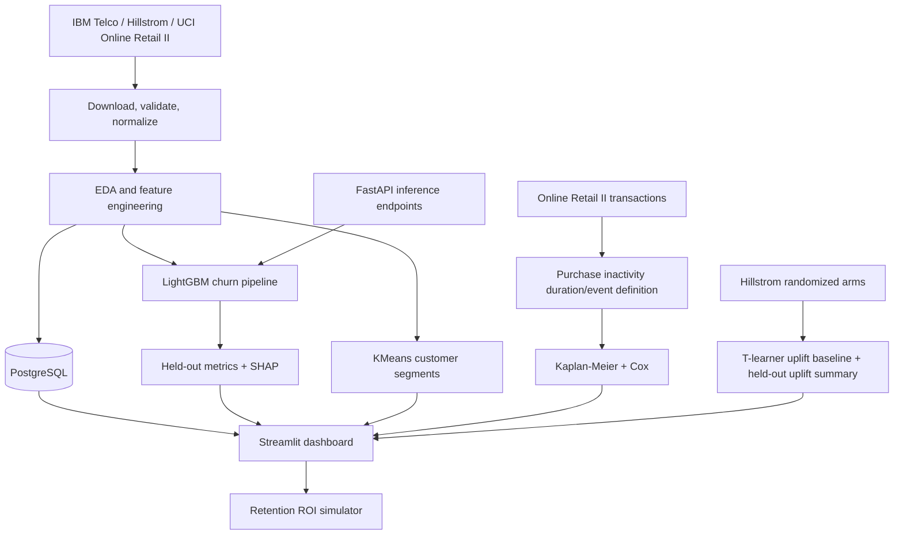

# Architecture

## Data flow
1. Download public datasets at runtime and preserve source provenance.
2. Normalize IBM Telco columns and report EDA/data-quality checks.
3. Train churn classifier on a stratified holdout; serialize preprocessing and estimator together.
4. Derive transaction-based CLV aggregates and an explicitly defined purchase-inactivity survival proxy from Online Retail II.
5. Fit a randomized campaign T-learner baseline using Hillstrom.
6. Load processed tables into PostgreSQL when `DATABASE_URL` is configured.
7. Expose dashboard and API; test key calculations and transformations.
